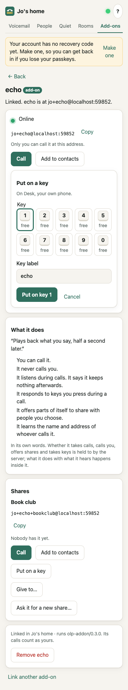
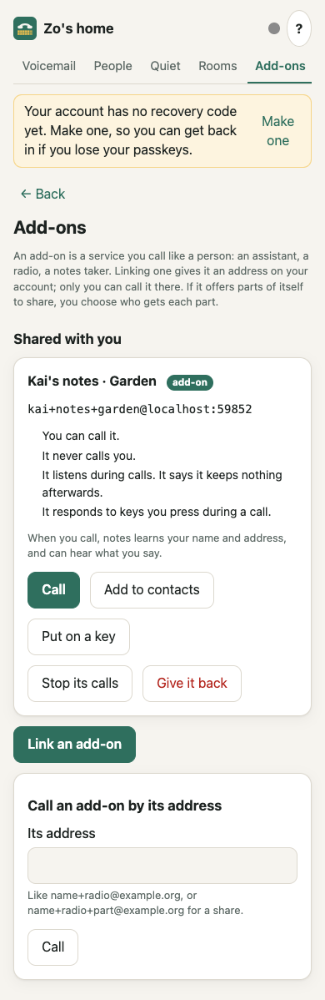

# Add-ons: services you can call

A phone call is a handset with a microphone and a speaker. Anyone could wire a computer to a
handset and put a program on the line. An **add-on** makes that a supported, optional part of
your account: any service that serves live voice (an assistant you think out loud with, a radio
station, a notes taker, a doorbell) gets an address on your account and joins calls like a phone
does.

Add-ons are not part of the default phone. A server offers them only if its operator turns them
on, and a person uses one only by linking it to their own account. Nothing in Open Lounge Phone
knows any particular add-on: each one says what it does, and the server holds it to the parts it
can check. Every add-on is treated as untrusted code; the rules are in
[security-model.md](security-model.md#add-ons).

## What an add-on is

- **An endpoint on your account.** Linking one gives it an address that is part of your account,
  such as `jesse+radio@hub.example`. Nothing separate to sign up for or manage. Removing it from
  your account revokes it at once.
- **Yours alone, unless it offers a part to share.** Only you can call it at its address, and
  without naming a share it calls only you. An add-on may offer parts of itself for sharing (one
  shared project, one station); you give such a part to specific people, and they reach that
  part, and only it, at its own address ([Sharing](#sharing)). Nobody can knock on an add-on, it
  never appears in a directory, and kids' phones can't reach one.
- **Told who's speaking.** Every call tells the add-on the verified caller: their address and
  name, checked by their server. It can greet people by name and keep separate memories per
  person. The app says so before you call it or give someone one of its shares.
- **It says what it does.** Whether it can be called, whether it calls you, whether it offers
  shares, whether it reacts to keys, how many calls it takes at once, and what it does with what
  it hears ([Saying what it does](#saying-what-it-does)). Its page in the app shows this in plain
  words.
- **Always marked as an add-on.** Apps show its name with an "add-on" badge; phones show
  `RADIO · ADD-ON` (the hardware phone's font writes `RADIO - ADD-ON`), and a call within a share
  shows the share with `ADD-ON CALLING` below it. Whatever its name or its shares' labels, it
  never shows as a person, a phone or the phone's own words.

## Turning add-ons on (operators)

Off by default. Self-hosted: `ADDONS=on` ([self-hosting.md](self-hosting.md)). Cloudflare:
`scripts/deploy.ts --addons` or `npx openloungephone deploy cloudflare --addons`
([cloudflare.md](cloudflare.md)); every deploy sets it, so leaving the flag out turns them off.

While add-ons are off, nobody can link one ("This server doesn't offer add-ons. Its operator can
turn them on."), add-ons linked earlier can't connect or be called (the app says so), and the
server doesn't list the `addons`, `addon-shares` and `addon-leave` features, so other servers
never offer it add-on calls or share grants.

## Using one: the Add-ons tab

The companion app has an **Add-ons** tab when the server offers add-ons (or you have some, or
someone shared one with you).



1. **Link.** Start linking in the add-on: it asks for your server's address and shows a 6-digit
   code. In the app, **Add-ons → Link an add-on**, type the code and choose its name (the part
   after `+`: 2 to 30 letters, digits, dots, dashes or underscores). It's linked in the space
   you're in.
2. **Put it on a key.** Right after linking, its page opens with **Put on a key** ready: your
   own phone and its first free key are chosen, so **Put on key 1** is one tap. Lift the
   handset, press the key. (From link to talking: 8 steps.) You can choose another phone or key,
   and change the key's label; a key that already calls someone says so first. Kids' phones
   never take add-ons and aren't offered.
3. **Call it** from its page (**Call**), or **Add to contacts**: it then shows on **Home** with
   a Call button.
4. **It calls you**, if it says it may, for a check-in it planned, say. It rings wherever you
   can be rung: your apps, your own phones, a Lounge phone you're signed in at.
5. **Its page** shows whether it's online now (as the server reports it), its address with
   **Copy**, where it's linked ("Linked to Jesse (jesse@hub.example), in Jesse's home, on
   hub.example"), **What it does**, its **Shares** (each with Call, Add to contacts, Put on a key and
   **Give to…**), **Ask it for a new share…** when it offers shares, and **Remove**: it's cut off
   at once, told to forget its link, and every share of it goes; the question names the shares
   and how many people lose them. With one add-on and nothing shared with you, the tab opens
   straight on its page.
6. **Nothing goes silently.** When an add-on is removed (by you, or because you left the space or
   the space went), the Add-ons tab keeps a note of it until you press OK: which shares went and
   who no longer has them. Someone holding a share gets a note too when it goes (its add-on was
   removed, its owner took it back, or the add-on stopped offering it), on their own server.
7. **Accounts on two servers.** An add-on shows on the app of the server it's linked to. To
   reach it from your account on another server, connect your two accounts (Connections), then
   on the add-on's server give that account a share of it.

**When a call doesn't go through**, the app and the phones say why: the add-on isn't connected
right now (`ADD-ON OFFLINE`), it takes no calls, it's on as many calls as it takes, add-ons are
off on that server, you're already on a call, or, for your own address, that no add-on of that
name is linked to your account on that server (`NO SUCH ADD-ON`: it may be linked on your other
server). Anyone who may not call an address hears only "You can't call that address", whether
anything is there or not.

A call with an add-on is one to one: no Add caller, no Transfer. The app shows a **Keypad**
during the call when it takes keys; it hears the keys ("press 1 to…"). Calls to and from an
add-on don't go to voicemail.

**Fair use:** an add-on's call minutes count against its owner's allowance, whoever placed the
call ([hub.md](hub.md)). **Audit:** linking, granting and revoking shares, a holder giving one
back, share requests and their results (made, refused, offline, no answer), limits reached and
removing it go in the space's audit trail (names, ids and counts, never content).

## Sharing

An add-on is personal by default: only its owner can call it at its address. Sharing is
something the **add-on defines**: it says which parts of itself can be shared. Open Lounge Phone
decides **who** gets each part and enforces it. A private assistant can't be opened up to
several people as a whole; only the pieces it offers can be shared.

**Each share has its own address:** `handle+name+share@host`, e.g.
`jesse+radio+listen@hub.example`. The plain add-on address stays its owner's alone; its owner may
also call within any share (the add-on is told `grantId` `owner`).

**Giving a share.** On the add-on's page, **Give to…** on a share, then choose one of your
connections (here or on servers that list `addon-shares`) or someone in your spaces. Before you
give it, the app says that the add-on will learn their name and address when they call, and can
hear what they say. The server keeps the grant (by the person's server and stable account id)
and refuses any call to the share's address from someone without one, with `unavailable` like
every refusal. A grant also stops working when that person is no longer your connection (or,
here, in one of your spaces). **Revoke** takes it back and ends their calls into it at once.

**Holding a share.** Under **Add-ons → Shared with you**, each share given to you shows what the
add-on said it does (for one on your own server), that it learns your name and address when you
call and can hear what you say, and:

- **Call**, **Add to contacts**, **Put on a key** (your own phones, never a kids' phone).
- **Stop its calls**: the add-on can't call you any more (you can still call it). Your own
  server enforces this, so it holds whatever the add-on's server does. **Let it call me** undoes
  it.
- **Give it back**: you lose the share and your calls within it end; its owner sees you gone.
  Across servers this uses `POST /fed/v1/addon-shares/leave` (feature `addon-leave`); with a
  server that doesn't have it, your server still forgets the share and refuses the add-on's calls
  to you within it.



**What the add-on is told.** A call that came in through a share carries it:

```json
← {"t":"call.ringing","callId":"call_…","from":{"label":"Ana","address":"ana@other.example"},
   "share":{"id":"listen","label":"Listen","grantId":"ag_…"}}
```

- No `share`: its owner is calling its own address. `grantId` `owner`: its owner within a share.
- `grantId` names the grant, so the add-on can attribute what happens to it.
- The add-on must keep the conversation inside that scope. The server can't see inside the
  add-on, so this part is the add-on's job, best enforced by its own permissions (a token limited
  to that one scope), not only by instructions to a model. The server's job is that nobody
  without a grant gets in.

**Ask it for a new share…** On its page (a name, people) sends:

```json
← {"t":"addon.share.request","requestId":"sr_…","label":"Garden","by":"jesse@hub.example",
   "with":["ana@hub.example","bob@other.example"]}
```

- The add-on makes the scope, sends its updated `addon.shares` (with the new share), then
  answers `→ {"t":"addon.share.created","requestId":"sr_…","id":"garden"}`. The server then gives
  the share to the people in `with`; the owner started it, so no second confirmation is needed.
- Or `→ {"t":"addon.share.refused","requestId":"sr_…","reason":"…"}` (shown to its owner).
- The app shows where it stands: waiting, done, refused with the reason, "offline" (it wasn't
  connected, so it wasn't asked) or "didn't answer" (no answer within a minute; a late answer is
  turned down with an `error`).

**Calling out within a share.** `→ {"t":"call.address","address":"ana@other.example","share":"listen"}`:
the add-on may call its owner, or a person who holds that share and hasn't stopped its calls. The
callee sees `call.ringing.from` `{"label":"radio","address":"jesse+radio+listen@hub.example",
"kind":"addon","share":"Listen"}`. Without `share` it may call only its owner.

**Who sees what.** The owner: the add-on's page lists its shares and who holds each. A holder on
the same server: Add-ons → Shared with you. Holders on another server: their server is told
(`POST /fed/v1/addon-shares`, feature `addon-shares`) and shows it under Add-ons and on that
connection. Nobody else, in the owner's household or anywhere, sees a private add-on or its
shares.

## Building one

The easy way is the **add-on bridge** ([sdk/python](../sdk/python/README.md), Python 3.10+,
**Apache-2.0**, so any service can use it; the rest of Open Lounge Phone is AGPL). It does the
linking, the key and the signed challenge, reconnects, and turns calls into events and plain PCM:

```python
import asyncio
from olp_addon import Addon

addon = Addon("https://hub.example", "echo.addon-key")   # its Ed25519 key, made on first use
addon.set_about(summary="Plays back what you say.", hears="live", keys=True)

@addon.on_call
async def talk(call):
    print("call from", call.caller.name, call.caller.address)   # verified by the server
    call.on_key = lambda key: print("pressed", key)
    await call.answer()
    async for frame in call.frames():   # 20 ms of 16-bit mono PCM, 48 kHz by default
        await call.send(frame)           # here: an echo; in a real add-on, its voice

asyncio.run(addon.run())   # prints the link code the first time, then takes calls
```

- `Addon(server_url, key_path, *, rate=48000, about=None)`: the key file is made with mode 600;
  the link is kept next to it (`<key_path>.json`). `rate` is the PCM rate both ways.
- `addon.set_about(hears, *, summary, transcribes, answers, calls, shares, keys, lines)`: what it
  does ([below](#saying-what-it-does)); sent after every connection.
- `await addon.link(on_code=print)`: shows the code (`on_code(code, expires_at)` also gets when
  it stops working), waits for its owner, saves the link.
- `addon.online` and `@addon.on_status`: whether it's connected now, and a handler for changes.
- `@addon.on_call`: gets each ringing `Call` (several at once, if it said `lines`).
  `await addon.run()` (or `start()`/`stop()`) stays connected; it raises `AddonRemoved` when its
  owner removes it.
- `await addon.call(address, share=None) -> Call`: calls its owner, or with `share` someone
  holding that share (`call.state` is `ringing`, or `ended` with `call.reason`).
- `addon.set_shares([{"id": …, "label": …}])`, `call.share`, `@addon.on_share_request`: see
  [Sharing](#sharing).
- `Call`: `.caller` (`.address`, `.name`), `.share`, `.callee`, `.state`, `.reason`,
  `await answer()`, `await hangup()`, `frames()`, `await send(pcm)`, `clear()`, `on_key`,
  `on_hangup`, `await wait_active()`, `await wait_ended()`.
- Audio is converted for you: apps send Opus, hardware phones PCMU; the bridge resamples.

The examples: `examples/echo.py` plays back what it hears half a second later (`#` hangs up);
`examples/radio.py` is one-way: it plays a tune to several callers at once and never reads what
they say. End-to-end tests link them through the companion in a browser and call them with real
audio (`tests/e2e/live/addon.test.ts`, `tests/e2e/live/addonTab.test.ts`, opt-in).

### Saying what it does

After connecting (before `addon.shares`), an add-on says what it does:

```json
→ {"t":"addon.about","summary":"Plays the station.","hears":"nothing","transcribes":false,
   "answers":true,"calls":false,"shares":true,"keys":false,"lines":10}
```

| Field | Meaning | Enforced by the server |
|---|---|---|
| `summary` | One plain sentence, up to 140 characters | shown as its words (plain text only) |
| `hears` | `nothing`: it only plays sound (one-way); `live`: listens, keeps nothing; `keeps`: keeps recordings, transcripts or notes | shown as its words |
| `transcribes` | It turns what it hears into text | shown as its words |
| `answers` | People can call it (default true) | yes: otherwise every call to it is `unavailable` |
| `calls` | It may call people (default false) | yes: otherwise its `call.address` is refused |
| `shares` | It offers parts to share (default false) | yes: otherwise `addon.shares` with any share is refused, and earlier shares go |
| `keys` | It reacts to keys (default false) | yes: otherwise no `call.key` reaches it, and apps show no keypad |
| `lines` | Calls it takes at once, 1–100 (default 1) | yes, capped at the server's limit (10); more callers hear busy |

It replaces what it said before. An add-on that never sends it keeps these rules: it can be
called, may call, may offer shares, gets keys, one call at a time; its page says it hasn't said
what it does. Servers list the device feature `addon-about`; the bridge sends it only to them.

### The protocol, for other languages

An add-on speaks the device protocol of a phone ([protocol.md](protocol.md)) over
`wss://<server>/ws/device` (`?device=<id>` once linked). Its address is `handle+name@host`:
`handle` is its owner's current handle (it follows a handle change), `name` the part after `+`,
`host` the server (with a port if it has one).

Linking:

```json
→ {"t":"hello","proto":1,"model":"addon","fw":"my-addon/1.0","buttons":1,"display":"none"}
→ {"t":"pair.begin","kind":"addon","alg":"ed25519","publicKey":"<raw 32-byte key, base64url>"}
← {"t":"pair.code","code":"123456","expiresAt":1790000000000}
← {"t":"pair.done","deviceId":"ao_…","householdId":"hh_…"}
```

Every connection after that (`/ws/device?device=ao_…`):

```json
→ {"t":"hello","proto":1,"model":"addon","fw":"my-addon/1.0","buttons":1,"display":"none","deviceId":"ao_…"}
← {"t":"auth.challenge","nonce":"<32 bytes, base64url>"}
→ {"t":"auth.proof","sig":"<Ed25519 signature over the raw nonce bytes, base64url>"}
← {"t":"config","buttons":[],"quiet":false,"now":1790000000000,"server":{…,"features":[…,"addons","addon-about"]},
   "addon":{"name":"radio","address":"jesse+radio@hub.example",
            "owner":{"name":"Jesse","address":"jesse@hub.example"}}}
→ {"t":"addon.about",…}   → {"t":"addon.shares",…}
```

A call to it:

```json
← {"t":"call.ringing","callId":"call_…","from":{"label":"Bob","address":"bob@other.example"}}
→ {"t":"call.answer","callId":"call_…"}
← {"t":"rtc.config","callId":"call_…","iceServers":[…]}
← {"t":"call.state","callId":"call_…","state":"connecting"}
← {"t":"rtc.sdp","callId":"call_…","type":"offer","sdp":"…"}        the caller offers
→ {"t":"rtc.sdp","callId":"call_…","type":"answer","sdp":"…"}
↔ {"t":"rtc.ice","callId":"call_…","candidate":"candidate:…","sdpMid":"0","sdpMLineIndex":0}
← {"t":"call.state","callId":"call_…","state":"active"}
← {"t":"call.key","callId":"call_…","key":"5"}                       a key on the app's keypad
→ {"t":"call.hangup","callId":"call_…"}   or   ← {"t":"call.state",…,"state":"ended","reason":"hangup"}
```

A call from it (people only: its owner, or, naming a share, someone who holds it; by address):

```json
→ {"t":"call.address","address":"jesse@hub.example"}
← {"t":"call.state","callId":"call_…","state":"ringing"}             or "ended" with a reason
← {"t":"rtc.config",…}  ← {"t":"call.state",…,"state":"connecting"}  once answered
→ {"t":"rtc.sdp","callId":"call_…","type":"offer","sdp":"…"}         it places the call: it offers
← {"t":"rtc.sdp","callId":"call_…","type":"answer","sdp":"…"}
```

Other rules:

- `{"t":"ping"}` → `{"t":"pong"}` keeps the socket open (every 25 s or so).
- Once signed in, an add-on may send only `ping`, `addon.about`, `addon.shares`,
  `addon.share.created`, `addon.share.refused`, `call.address`, `call.answer`, `call.hangup`,
  `rtc.sdp` and `rtc.ice` (without `peer`). Anything else is answered with
  `{"t":"error","code":"bad_message","message":"not for add-ons: …"}` and does nothing.
- Words people will read (share labels, `summary`, a refusal's `reason`, its `fw`) are plain
  text: control, format (such as right-to-left overrides), private-use and line-break characters
  are refused with an `error`.
- It takes `lines` calls at once (default 1; each answered call goes on beside the others) and
  places one call at a time. Every refusal of a call to or from it — unknown, not allowed, add-ons
  off, its owner suspended — ends `unavailable` (or `denied` with a `note`, for fair use and the
  limits below).
- Removed by its owner (or its owner left the space it was linked in), it gets
  `{"t":"wipe","reason":"removed"}` and the socket closes; it should forget its id. Its owner
  suspended: `{"t":"error","code":"unauthorized",…}` and it can't connect until that's lifted.
  With add-ons off, the server answers its `hello` or `pair.begin` with
  `{"t":"error","code":"unauthorized","message":"This server doesn't offer add-ons. Its operator can turn them on."}`
  and closes.

### Limits

Every limit is in `packages/server-app/src/limits.ts` (operators can change them).

| Limit | Default | Over it |
|---|---|---|
| Calls one add-on takes at once (`addon.about.lines` asks for up to this) | 10 | busy |
| Longest call with an add-on | 4 hours | the call ends ("Calls with add-ons end after a few hours.") |
| Calls one add-on places per hour | 10 | `denied` + note; audited once |
| Calls one add-on places to one person per day | 6 | `denied` + note; audited once |
| Calls one person places to one add-on per hour | 30 | `denied` + note |
| Share lists (`addon.shares`) per hour | 60 | `error` `rate_limited`, list unchanged |
| Connections (signed in) per hour | 120 | `error` `rate_limited`, closed (4429) |
| Messages per minute on one connection | 600 | `error` `rate_limited`, closed (4429), its calls end |

TURN credentials for a call with an add-on are made only once it's answered, last no longer
than the longest call, and on Cloudflare are revoked when it ends.

### Across servers

Calls to and from add-ons on other servers use the federation feature `addons`
([federation-spec.md](federation-spec.md)): the `addon` call target
(`{"kind":"addon","handle":"jesse","name":"radio"}`) and, for a call from an add-on,
`CallBody.addon` (its name; `from` is its owner and `to` must be a person). Shares add the feature
`addon-shares`: the target's `share`, `CallBody.addonShare` (for a call from an add-on within a
share) and `POST /fed/v1/addon-shares` (the shares a person there holds, for their server to
list). `addon-leave` adds `POST /fed/v1/addon-shares/leave` (a holder there gives one back).

The add-on's server decides every call into it by its own grants. The holder's server decides
calls from it: it rings a person only within a share that the add-on's server told it they hold,
with the label it was told, and never once they stopped its calls. A call through a kids' phone
or a guest is refused; a server that doesn't list `addons` is never offered add-on calls ("That
server doesn't take add-on calls"), and one that doesn't list `addon-shares` can't receive grants
or calls into shares ("That server doesn't take shared add-ons yet"). Keys travel as `call.key`
on the server-pair stream.

### The app's side (HTTP)

- `GET /api/addons`: yours, with `online` as the server sees it, `about` (what it said, or
  null), `rules` (what the server lets it do), `shares` (`id`, `label`, `address`, `holders` with
  `grantId`, `name`, `address`), `allowNote`, and whether the server offers add-ons.
  `POST /api/addons/link {code, name}`. `DELETE /api/addons/:id`.
- `GET /api/addons/people`: who you can give a share to (`ref` `conn:<id>` or `user:<id>`,
  `name`, `address`, `where`). `POST /api/addons/:id/shares/:share/grants {to: ref}` →
  `{grantId, name, address}`; `DELETE /api/addons/:id/grants/:grantId`.
- `POST /api/addons/:id/share-requests {label, with: [ref]}` and
  `GET /api/addons/:id/share-requests/:requestId` → `{id, label, state, shareId?, reason?,
  people}`, `state` one of `waiting`, `created`, `refused`, `offline`, `timeout`.
- `GET /api/addons/gone`: notes of what went (`what` `removed`: your add-on, with `shares`
  `[{label, holders}]`; `share`: a share you held, with `owner` and `label`), newest first, at
  most 20; `DELETE /api/addons/gone/:id` dismisses one. Each add-on in `GET /api/addons` also
  says `owner` (`name`, `address`) and `server`.
- `GET /api/addons/shared`: shares of other people's add-ons on this server given to you
  (`owner`, `addon`, `share`, `address`, `muted`, `about`); shares from other servers come with
  that connection in `GET /api/connections` (`addonShares`, with `muted`).
- `PUT /api/addons/muted {address, muted}`: stop (or allow again) an add-on's calls to you.
  `POST /api/addons/leave {address}`: give a share back.
- `GET /api/addons/contacts`, `PUT /api/addons/contacts {address, label?}`,
  `DELETE /api/addons/contacts {address}`: add-ons (and shares) you may call, in your contacts on
  Home (`ok`: you can call it now).
- `PUT /api/devices/:id/lines {address, label, key?}`: put an add-on's (or share's) address on
  one of your own phones, on key `key` in the same step. Phones learn which keys call add-ons
  (`config.buttons[].addon`) and show them as such while calling.
- Apps call an add-on or a share with `call.address` and send keys with `call.key`.

## Examples

- **An assistant you think out loud with.** It says `hears: "keeps"` and `transcribes: true`, so
  its page tells you it keeps what it hears. It offers each shared project as a share; someone
  you give one to calls that project's address, and it works only inside it.
- **A radio.** It says `hears: "nothing"`, `lines: 10`, `calls: false`, and offers one share,
  "Listen", that its owner gives to a few people. They put it on a key; it never calls them, and
  its page says so.
- **A doorbell or a reminder.** It says `answers: false` and `calls: true`: it can only call its
  owner (or holders within a share), a few times a day at most.

## Not built yet

- Shares that carry actions too (the add-on declares them, e.g. "add a task", and the app shows
  them as buttons; the add-on does the work).
- Add-ons that receive voicemail or send notices.
- Keys from hardware phones during a call (today only the apps' keypad sends them).
- The hardware phone shows the add-on's name with `ADD-ON` for a call within a share, without the
  share's label.
